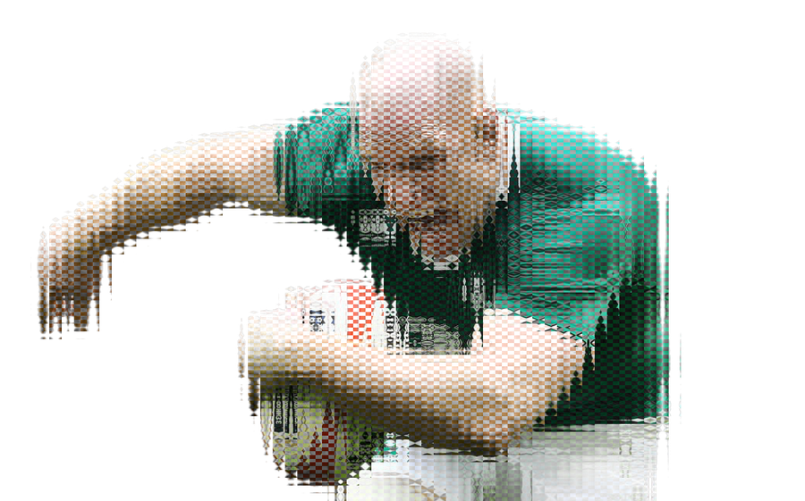
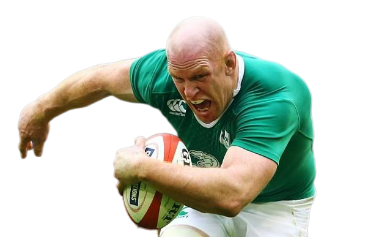
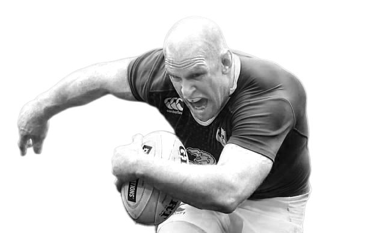
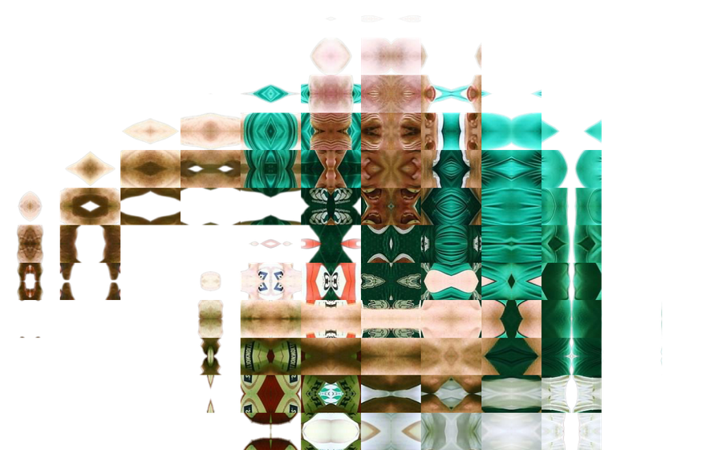
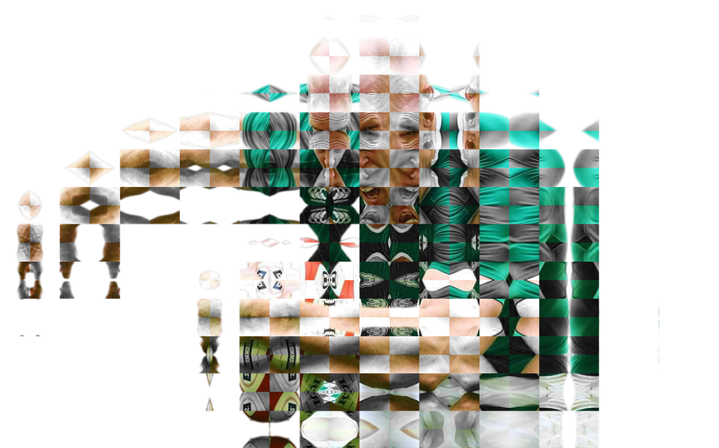
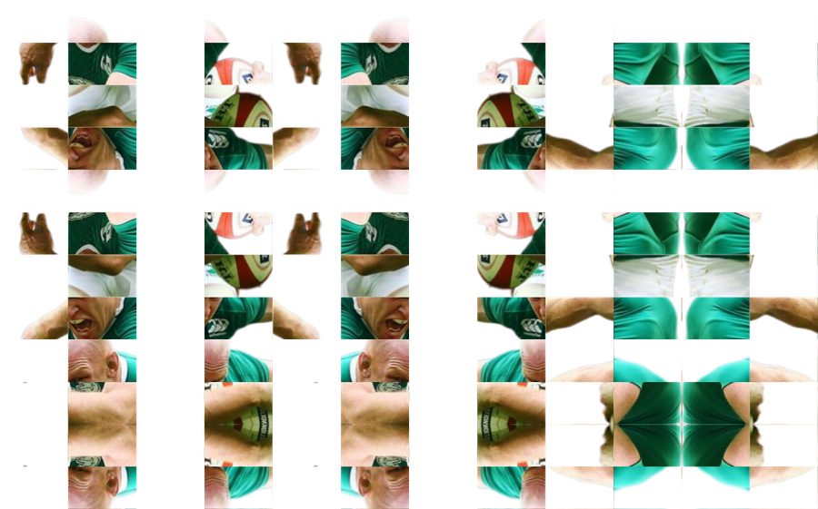
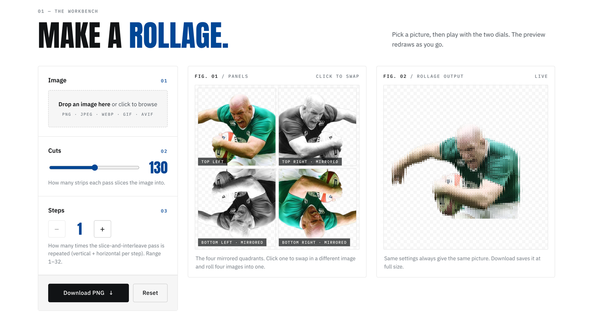
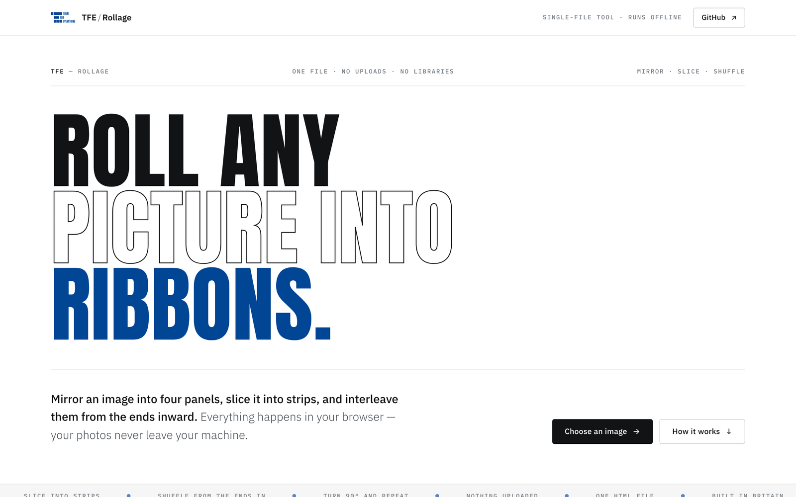

# Rollage

**Roll any picture into ribbons.** 
Mirror it, slice it, shuffle it — right in your browser.

---

## What is a rollage?

A *rolled collage* is an old paper-craft trick: cut a picture into strips and
weave it back together. Rollage does it in code, in four moves:

| | Move | What happens |
|:-:|---|---|
| **01** | **Mirror** | The picture is mirrored into four panels — like folding paper before cutting a snowflake — so every edge matches its neighbour. |
| **02** | **Slice** | The mirrored base is cut into *Cuts* vertical strips. |
| **03** | **Shuffle** | The strips are re-ordered from the ends inward: `1 8 2 7 3 6 4 5`. |
| **04** | **Turn & repeat** | The same trick runs on the rows, then everything repeats *Steps* times. |

## One image, or mix in a second

Start with one picture and every panel uses it. Click any panel to swap in a
**different** picture, and the two get woven together. Here's the same photo in
colour, and then with a black-and-white copy in two of the four panels:

<table>
  <tr>
    <th width="33%">The inputs</th>
    <th width="33%">One image</th>
    <th width="33%">Two images mixed</th>
  </tr>
  <tr>
    <td> </td>
    <td></td>
    <td></td>
  </tr>
  <tr>
    <td align="center">Colour + black &amp; white</td>
    <td align="center">130 cuts · 1 step</td>
    <td align="center">130 cuts · 1 step · B&amp;W in top-right and bottom-left</td>
  </tr>
</table>

### The dials change everything

Lots of cuts gives fine ribbing. Fewer cuts gives big, kaleidoscope-like
tiles. More steps keeps scrambling them.

<table>
  <tr>
    <td width="33%"></td>
    <td width="33%"></td>
    <td width="33%"></td>
  </tr>
  <tr>
    <td align="center">One image · 24 cuts · 1 step</td>
    <td align="center">Two images · 24 cuts · 1 step</td>
    <td align="center">One image · 12 cuts · 3 steps</td>
  </tr>
</table>

## How to use it

1. **Image:** drop a photo anywhere on the page, or click the dashed box to browse.
2. **Panels:** you'll see the four mirrored quadrants. Click one to swap in a different picture.
3. **Cuts** (2–256): how many strips each shuffle uses.
4. **Steps** (1–32): how many times the shuffle repeats.
5. **Download PNG:** saves your rollage at full size.

> [!TIP]
> Try a photo with strong colours meeting at an edge (they smear into ribbons),
> four completely different photos in the four panels, or 64+ cuts at 1 step
> against a few cuts at many steps. They give very different looks.

## Run it anywhere

**One file. No installs, no servers, no uploads.** Download
[`index.html`](index.html), double-click it, and it opens in your browser.
Everything happens on your own computer, and your photos never leave it.
You can even email the file to a friend.

- Works in any modern browser, on desktop and phone.
- Very large photos are scaled to fit browser limits: the preview is capped at
  2048px, and the download at 4096 × 4096 pixels' worth. iPhones refuse
  anything bigger.
- iPhone **HEIC** photos can't be decoded by Chrome or Firefox. Export them as
  JPEG or PNG first (the app will tell you if you try).

## The look

Rollage wears the **TFE** (*There For Everything*) house style, taken from the
design tokens in [tfeSvelteTemplates](https://github.com/Jktfe/tfeSvelteTemplates):
brand blue `#004695`, Anton headlines, IBM Plex Sans and Mono, thin rules, and
the ink footer. It follows your system's light/dark setting.

The fonts are the only thing the page fetches from the internet. Offline, it
falls back to fonts already on your computer and works just the same.

## For the curious

The whole app is a single `index.html`, hand-written in plain HTML, CSS and
JavaScript with **no libraries**. It's heavily commented in plain language,
explaining not just *what* the code does but *why* each choice was made. Open
it in a text editor and have a look: it's meant to be read.

---

Made by <a href="https://github.com/Jktfe">@Jktfe</a> · <a href="https://tfeltd.com">TFE Ltd</a> · MIT licence

